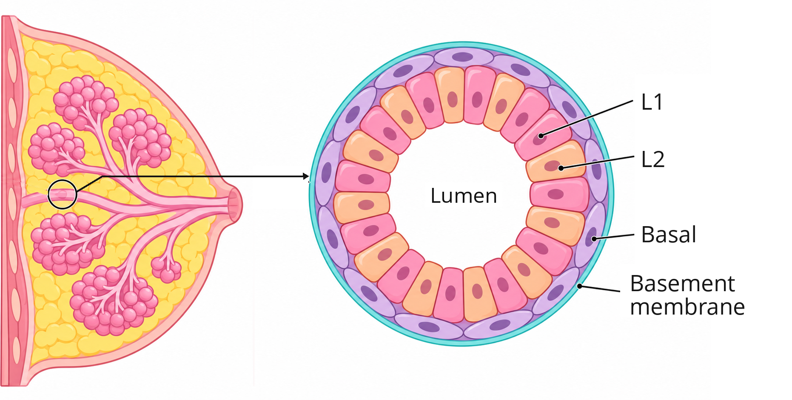

# Interactome-based versus Transcriptomic Representations for Single-cell Classification of Breast Epithelium

## Overview

This project presents a computational pipeline for the classification of human breast epithelial cells using single-cell gene expression data and protein–protein interaction (PPI) information.

The main objective is to compare two feature representations for cell type classification:

- **Gene Expression (GE):** classification based exclusively on transcriptomic features.

- **Gene Expression + Protein–Protein Interactions (GE + PPI):** classification incorporating interactome-based features derived from gene expression and protein interaction networks.

In addition to evaluating classification performance, the project explores the interpretability of interactome-based representations using SHapley Additive exPlanations (SHAP).

## AIMS
- **Generalization:** Does it work on unseen donors and labs?
- **Performance:** Can it compete with expression alone?
- **Interpretability:** Does the interactome make the classifier easier to interpret?

## Dataset
The study integrates single-cell RNA-seq data from:
- **Nguyen et al. (2018):** Breast epithelial cells used for model training and donor-level validation.
- **Twigger et al. (2022):** Non-lactating breast epithelial cells used as an independent dataset for external validation.
- **Luck et al. (2020):** HuRI human protein-protein interaction network.

Three distinct epithelial populations are classified:
- **B: Basal:** Myoepithelial cells

KRT5 · KRT14 · ACTA2

- **L1: Luminal progenitor:** Highly proliferative luminal epithelial cells

KIT · SLPI · ALDH1A3

- **L2: Mature luminal:** Hormone-responsive luminal epithelial cells

ESR1 · PGR · FOXA1

  

  <em>Figure 1. Representation of human breast epithelial cell populations.</em>

## References
1. Nguyen, Q.H. et al. (2018). Nat. Commun., 9, 2028. https://doi.org/10.1038/s41467-018-04334-1
2. Twigger, A.J. et al. (2022). Nat. Commun., 13, 562. https://doi.org/10.1038/s41467-021-27895-0
3. Luck, K. et al. (2020). Nature, 580, 402–408. https://doi.org/10.1038/s41586-020-2188-x
